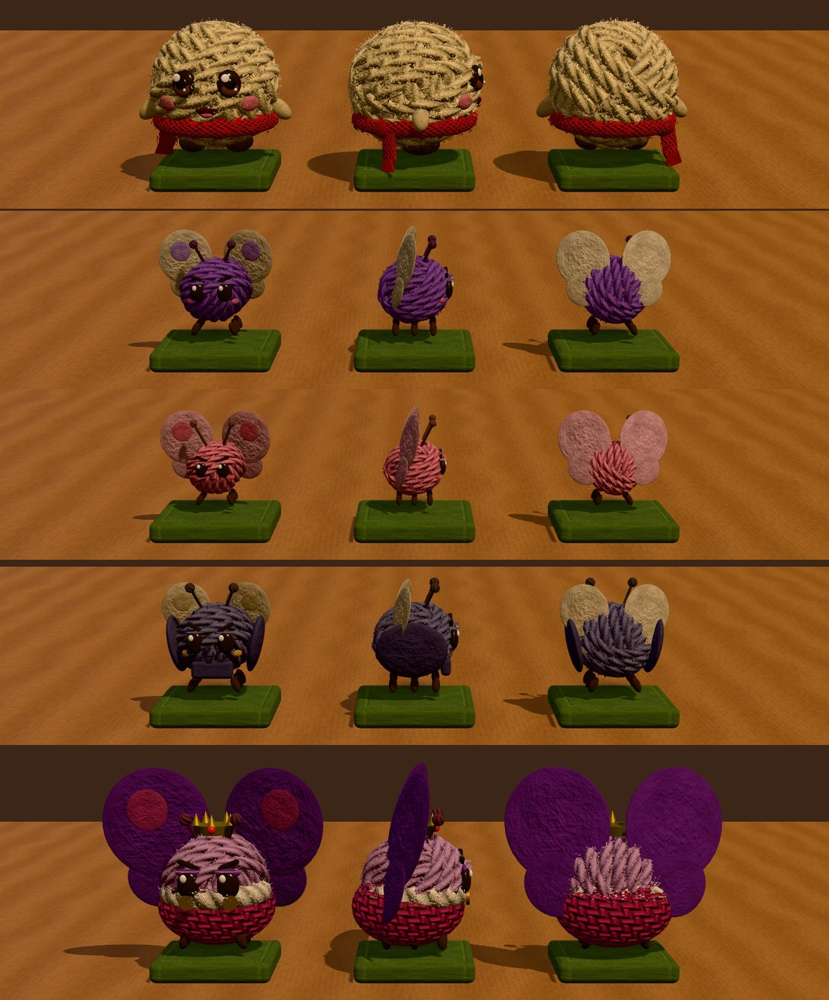
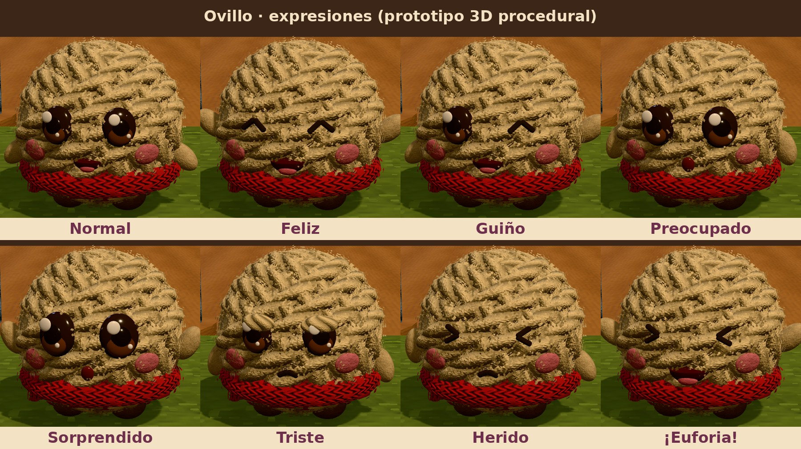
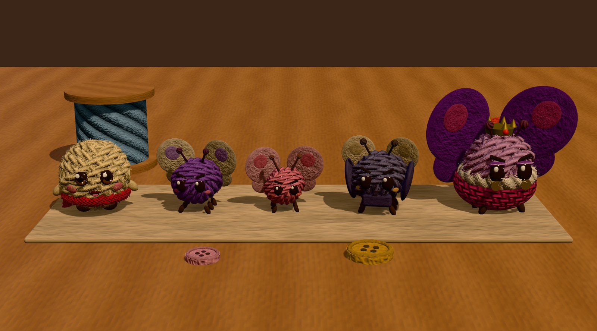
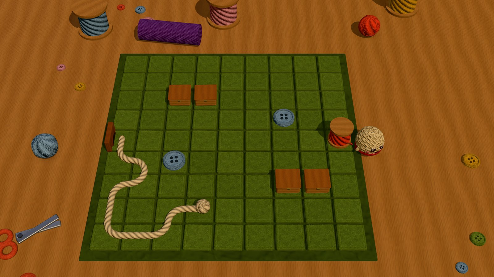

# 4. Dirección de arte — 3D artesanal adorable

> **Decisión:** un pequeño **diorama 3D** de un taller de costura, construido con lana, fieltro, madera, botones y tela, que parece una maqueta hecha a mano que ha cobrado vida. Nada de 2D con sombras: volumen real, materiales que responden a la luz y animación con aire de *stop motion*.
>
> **Referencia de acabado:** la **hoja de Ovillo** (`Docs/Arte/referencias/ovillo_hoja_referencia.png`). Ovillo debe ser *igual* que en ella y todo el juego debe tener ese aire: foto macro de juguetes de lana y fieltro, hebras gruesas con pelusa, colores cálidos, fondo desenfocado.

*Ovillo en el prototipo actual, hecho a partir de su hoja de personaje con geometría procedural (sin modelos externos) y renderizado fuera de Unity con la misma geometría y materiales que usa el juego. Es un placeholder jugable, no el arte final.*

## 4.1 Referencias oficiales

| Referencia | Archivo | Uso |
|---|---|---|
| **Hoja de Ovillo** (referencia principal) | `Docs/Arte/referencias/ovillo_hoja_referencia.png` | Modelo, materiales, colores, vistas de frente/lado/espaldas y expresiones de Ovillo; acabado de todo el juego. |
| Ovillo (primer render de referencia) | `Assets/_Project/Resources/Arte/Personajes/ovillo.png` | Retrato de la interfaz y pantalla de victoria (hasta tener el arte final). |
| Hoja de personajes | `Docs/Arte/referencias/hoja_personajes.png` | Silueta, colores y expresiones de las cuatro polillas; estilo de etiquetas de fieltro de la interfaz. |
| Retratos recortados | `Assets/_Project/Resources/Arte/Retratos/*.png` | Fichas de "Conoce a las polillas", vista de la oleada. |
| Placeholders 3D | `Docs/Arte/vista_previa_3d_*.jpg`, `Docs/Arte/giros_personajes_provisionales.jpg`, `Docs/Arte/ovillo_*_3d.jpg` | Proporciones, escala de juego y expresiones para el modelado final. |

## 4.2 Paleta

Colores medidos sobre las referencias (cuentagotas sobre la imagen de Ovillo y la hoja de personajes) y fijados en `Paleta.cs`. La paleta global es cálida y poco saturada.

| Uso | Color | Hex |
|---|---|---|
| Lana de Ovillo (hebras / fondo entre hebras) | crema cálido (hoja de Ovillo) | `#F8DDA8` / `#D9AF78` |
| Bracitos de Ovillo | fieltro crema | `#F0D2A0` |
| Bufanda de punto | rojo | `#C8232C` (flecos `#B81F28`) |
| Botas | marrón fieltro | `#6B3920` |
| Mofletes / lengua | rosa fieltro | `#F5929F` / `#FF8A9C` |
| Ojos (globo / iris / pupila) | marrón muy oscuro con iris castaño | `#2B140A` / `#6E3819` / `#140703` |
| Fieltro del tablero (oscuro / base / claro) | verde musgo | `#3F5525` / `#5E7A36` / `#7A9849` |
| Polilla común | lila / alas crema | `#9467B8` / `#F3DEC0` |
| Polilla veloz | rosa / alas rosa claro | `#EE8C9E` / `#F7BCC7` |
| Polilla acorazada | gris pizarra / faldones | `#7D7896` / `#5E5A78` |
| Reina | lila rosado / alas morado / capa magenta / oro | `#D7A2C8` / `#7B3F94` / `#B8395E` / `#E8BE4A` |
| Madera | miel | `#B98352` → `#9A6538` |
| Interfaz: títulos | ciruela (como el logo de la hoja) | `#6E2F4C` |

**Reglas de lectura:**
- **La lana del recorrido es crema** (la de Ovillo) y no roja: el rojo sobre verde es la combinación que peor distinguen las personas con daltonismo (contraste de luminancia ≈ 1,4:1). Crema sobre musgo da ≈ 3,8:1. En Ajustes se puede elegir crema, coral o azul.
- **El rojo se reserva** para Ovillo (bufanda), el hilo del carrete (la vida) y avisos.
- Cada polilla se distingue **por silueta y tamaño**, no solo por color: común redonda mediana; veloz pequeña con alas grandes y antenas largas; acorazada grande y ancha con faldones; Reina enorme con capa, cuello y corona.

## 4.3 Materiales

El aspecto textil debe salir del **material**, no de la geometría. Ninguna superficie debe parecer plástico.

| Material | Prototipo (ya implementado) | Versión final (vertical slice) |
|---|---|---|
| **Lana** | URP Lit + textura procedural de **3 cabos en hélice** y mapa de normales (`TexturasTres.Lana`); suavidad 0,12. Los cuerpos de Ovillo y de las polillas son **ovillos de hebras**: haces de 4 vueltas paralelas de tubo retorcido que se cruzan (`Mallas.OvilloDeHebras`). | Shader Graph *Textil*: albedo + normal de hebras + **pelusa por Fresnel** (borde claro y suave) + iluminación envolvente (*wrap*) para que la luz "entre" en la lana. |
| **Pelusa** | **Capas (*shells*) con recorte alfa**: 1–3 copias de la malla infladas a lo largo de las normales; cada fibra (2×2 píxeles) tiene una altura al azar y las capas exteriores solo conservan las más altas (22 %, 14 %, 6 %). De frente apenas salpica; en el contorno las capas se apilan y forman el borde mullido y deshilachado. UV octaédricas en esferas (sin polos) y UV propias en tubos y cajas. La pelusa deja libre la cara de las polillas. | Igual o *Textil* con Fresnel; en primeros planos, 4–6 capas. |
| **Punto (bufanda)** | Textura procedural de **punto de media**: columnas de "uves" de lana gruesa (`TexturasTres.Punto`) sobre tubos (vuelta, punta colgante) | Textura pintada de punto con normal; flecos modelados. |
| **Sombras de contacto** | Mancha radial suave bajo personajes y objetos (`Constructor.CrearSombra`, shader de sprites). La de los personajes se queda pegada al suelo aunque salten o vuelen y se encoge y aclara con la altura (así se lee la casilla de una polilla en el aire). | Igual (o *decal* de URP). |
| **Fieltro** | Ruido de fibras + normal; suavidad 0,06. Las casillas llevan una capa de pelusa (fieltro "musgoso", como el suelo de la hoja). | Igual + *Textil* con menos pelusa; costuras como textura (no geometría). |
| **Tela** | Trama/urdimbre procedural | Textura de tejido + normal; pliegues modelados solo en la capa de la Reina. |
| **Madera** | Veta suave de bajo contraste | Textura tileable con veta y poro; bordes redondeados en el modelo. |
| **Metal** (alfileres, tijeras, dedal) | Metálico 0,85, suavidad 0,6 | Igual + algo de desgaste en la rugosidad; necesita una *reflection probe* en la escena. |
| **Botones** | Suavidad 0,42 con fibra sutil | Resina/madera con brillo medio; agujeros modelados. |

## 4.4 Personajes — fichas de producción

Escala de juego: **1 casilla = 1 unidad de Unity**. Medidas para el modelo final (alto sin antenas).

### Ovillo — protagonista

Debe ser **igual que en su hoja** (`Docs/Arte/referencias/ovillo_hoja_referencia.png`).

| | |
|---|---|
| Silueta | **Bola de lana** de hebras gruesas enrolladas, **bufanda roja de punto** con nudo y punta con flecos (cuelga a su derecha), **bracitos** cortos de fieltro y **botas** marrones redondas. Se reconoce a 40 px de alto. |
| Cara | **Ojos grandes y brillantes** (≈ 1/5 del ancho de la bola cada uno): globo marrón muy oscuro, iris castaño abajo, reflejo grande arriba a la izquierda y otro pequeño abajo a la derecha. **Mofletes** redondos de fieltro rosa. **Boca abierta** en forma de "D" con lengua rosa. |
| Medidas | Ø bola **≈ 0,76** (0,99 en el tablero, a escala 1,3), alto total 0,78; ojos a la altura del centro de la bola; bufanda en el tercio inferior, sin tapar la boca; botas medio escondidas bajo la bola. |
| Materiales | Hebras de lana crema con torsión de cabos y **pelusa**; núcleo algo más oscuro (las rendijas entre hebras se ven hondas); bufanda de **punto de media**; bracitos y botas de **fieltro** con pelusa; ojos de resina brillante. |
| Expresiones | Las de la hoja y alguna más (ver la hoja 3D de abajo): **Normal** (sonrisa abierta), **Feliz** (ojos "^ ^"), **Guiño**, **Preocupado**, **Sorprendido** (ojos muy abiertos y boca en "o"), **Triste** (párpados a media altura, boca triste), **Herido** (ojos "&gt; &lt;" y boca triste), **¡Euforia!** (ojos "&gt; &lt;" y boca abierta, al saltar celebrando) y parpadeo. Cada ojo tiene su propio grupo, así el guiño y los "&gt; &lt;" son por ojo. |
| Animaciones | **Ya en el prototipo:** respirar, parpadear, llegar andando al empezar la sala, **tropezar** con su hebra (salas pares), mirar a la polilla más cercana, preocuparse si se acerca al carrete, **guiñar** cuando la lana llega al carrete, **dolerse** con cada mordisco, saltito cuando cae una polilla, **correr** asustado mientras se comen el carrete, tristeza y **celebrar** con confeti. La punta de la bufanda ondea al correr y saltar; los bracitos se alzan girando hacia arriba. |
| Presupuesto (arte final) | 4.000–6.000 triángulos de malla + pelusa por shader · texturas 1024² (color, normal, máscara) · rig de 16–20 huesos (raíz, cuerpo con *squash*, 2 brazos, 2 pies, 3 de bufanda, 2 ojos, 2 párpados, boca). El placeholder procedural usa ~15.000 triángulos de hebras más las capas de pelusa; solo es aceptable porque Ovillo es uno. |

### Polilla común

| | |
|---|---|
| Silueta | **Ovillo de hebras** lila (como Ovillo, con pelusa) con dos pares de **alas de fieltro crema detrás, en V**, con pespunte y manchas lilas; antenas curvas con bolita; 6 patitas marrones; **cejas enfadadas**. Parpadea, aprieta los ojos al recibir un golpe, los entorna pegada o enredada, los cierra deslumbrada y pone **ojos en X** al caer. |
| Medidas | Cuerpo Ø 0,56; envergadura ~0,9. |
| Animaciones | Idle (rebote + aleteo), trotar por la lana, recibir daño, quedar pegada, enredada, deslumbrada, morir (bolitas de fieltro), escapar hacia el carrete. |
| Presupuesto | 2.000–3.000 triángulos · 512² · **esqueleto compartido** con la veloz y la acorazada (raíz, cuerpo, 4 alas, 2 antenas de 2 huesos, 3 pares de patas = ~16 huesos). |

### Polilla veloz

Más pequeña (Ø 0,46), **alas más grandes y erguidas**, antenas largas, rosa. Animación propia: **vuelo** (alas rápidas, cuerpo levantado, sombra que se encoge) y aterrizaje con aplastamiento. Mismo esqueleto que la común.

### Polilla acorazada

Grande y ancha (Ø 0,64), gris pizarra, **faldones y peto de fieltro cosido** (piezas separadas para que se caigan al romperse la placa), mejillas color mostaza, cejas más inclinadas. Animaciones propias: caminar pesado, **perder la placa**.

### Reina de las polillas

| | |
|---|---|
| Silueta | La más grande (Ø 0,82): cuerpo lila rosado, **alas moradas enormes** con manchas magenta y ribete rosa, **cuello de piel crema**, **capa magenta** de tela con botones dorados, **corona** con gema roja, sombra de ojos y pestañas. |
| Animaciones | Presentación (entrada de 2 s), idle majestuoso, caminar, **comerse una herramienta**, **llamar a su corte**, recibir daño, dar otra vuelta, derrota. |
| Presupuesto | 6.000–8.000 triángulos · 1024² · rig propio (~24 huesos: capa con 3, corona como hueso fijo). |

### Coherencia entre personajes

Mismos materiales (ovillos de hebras con pelusa, fieltro, punto), mismos ojos (esferas oscuras brillantes con dos reflejos blancos), mismas cejas de fieltro, misma proporción cabeza-cuerpo (son "bolas con cara"), mismo grosor de pespunte. **Un solo artista o un solo kit de piezas** para todos.

## 4.5 Tablero, objetos y escenario

- **Casillas:** cojines de fieltro 0,92 × 0,16 × 0,92 con bordes redondeados, pespunte claro y una capa de pelusa (fieltro musgoso), ligeramente girados al azar (±1,5°) para que parezcan cosidos a mano; separadas para que la cuadrícula se lea sin líneas dibujadas.
- **Sombras de contacto** bajo personajes, obstáculos, carrete, lámparas y decorado: asientan cada pieza en el fieltro o en la mesa.
- **Tapete** verde oscuro acolchado bajo las casillas; **mesa de madera** debajo.
- **Obstáculos** (bajos, ≤ 0,6 de alto, para no tapar casillas): caja de costura, botón gigante, dedal, carrete pequeño, acerico, metro.
- **Agujero del rodapié** en el borde (entrada) y **carrete** con hilo rojo (salida): su grosor de hilo **es la vida**.
- **Lámpara** con pantalla de fieltro mostaza, bombilla emisiva y luz cálida que hace un charco de luz sobre las casillas vecinas.
- **Decorado** alrededor (bobinas gigantes, ovillos, botones sueltos, rollo de tela, tijeras): **solo detrás y a los lados**, nunca en el lado de la cámara. El postproceso los desenfoca.

## 4.6 Cámara e iluminación

*(La sección 14 del prompt llegó cortada; esta es la propuesta del equipo, ya implementada en el prototipo.)*

- **Cámara de maqueta:** perspectiva con **30° de campo** (sensación de miniatura, poca deformación), **inclinación 55°** (se ven todas las casillas y las caras de los personajes), fija. Rueda = zum ±25 %; **Q/E = girar la maqueta ±30°** para lucir el 3D sin perder la lectura. El encuadre se calcula solo para que el tablero ocupe el hueco central de la interfaz a cualquier resolución.
- **Luz:** "ventana" cálida (#FFDFB4) desde arriba a la izquierda con **sombras suaves**; relleno frío muy suave desde el lado contrario; ambiente de tres tonos (techo crema, paredes beige, suelo madera); luces puntuales cálidas en las lámparas.
- **Postproceso (URP), buscando el aire de foto macro de la hoja de Ovillo:** desenfoque gaussiano del fondo a partir de ~17 unidades (efecto *tilt-shift*), **balance de blancos cálido**, colores algo más saturados, bloom suave en los brillos de los ojos y en las bombillas, viñeta y mapeado de tonos neutro. Niebla lineal oscura al fondo.
- **Presentación de la Reina:** la cámara se acerca al agujero mientras aparece su rótulo (ver `05_Interfaz_audio_animacion.md`).

## 4.7 La lana del recorrido

Un **tubo de 0,22 de grosor** que sigue el recorrido con curvas de radio media casilla, ligeramente hundido en el fieltro (contacto) y que proyecta sombra. La textura tiene **tres cabos en hélice** (la torsión se ve al girar el tubo) y mapa de normales. Al tejer, **el último tramo crece** en vez de aparecer de golpe y un **ovillito rueda en la punta**, cada vez más pequeño según se gasta el hilo (se ve cuánto queda sin mirar la interfaz); al llegar al carrete desaparece: la hebra queda atada. Extremos redondeados.

## 4.8 Interfaz

Etiquetas y paneles de **fieltro con pespunte**, botones como parches cosidos, iconos de los propios objetos de costura, títulos en ciruela como el logo de la hoja de personajes. En el prototipo se dibuja con IMGUI y texturas generadas; la versión final se hará con UI Toolkit y piezas pintadas (ver `05_Interfaz_audio_animacion.md`).

## 4.9 Pipeline de producción (Blender → Unity)

1. **Modelado** en Blender a escala real de juego (1 casilla = 1 m), pivote en los pies, frente mirando a −Y de Blender (−Z de Unity).
2. **Nombres de grupo** iguales a los del placeholder para que el código siga encontrando las piezas mientras se sustituyen las animaciones procedurales por clips. Ovillo: `cuerpo`, `brazo_izq`, `brazo_der`, `pie_izq`, `pie_der`, `bufanda`, `cola_bufanda`, `cara`, y por cada ojo `ojo_*`, `parpado_*`, `feliz_*`, `apretado_*`; bocas `boca_feliz`, `boca_o`, `boca_triste`. Polillas: `cuerpo`, `ala_izq`, `ala_der`, `patas`, `ojos`, `parpados`, `ojos_x`, `cara`, `placas`, `capa`, `corona`. Las piezas de expresiones alternativas empiezan ocultas.
3. **Texturas** a 1024² (personajes principales) o 512² (polillas normales, herramientas); tileables de 512² para lana, fieltro, madera y tela. Exportar color (sRGB), normal (OpenGL, +Y) y máscara (rugosidad/pelusa).
4. **FBX** con *Apply Transform*, escala 1, solo deformadores en el rig. Animaciones como acciones separadas.
5. **Animación stop motion:** claves cada 2 fotogramas a 24 fps (12 poses/s), con *squash and stretch* exagerado. El placeholder de Ovillo ya se actualiza a 12 poses por segundo.
6. En Unity: modelo en `Assets/_Project/Arte/Modelos`, *Animation Type: Generic*, materiales con el shader *Textil*.

## 4.10 Lista de arte para la vertical slice (por prioridad)

| Prioridad | Pieza | Estimación (una persona) |
|---|---|---|
| 1 | Shader Graph *Textil* + texturas finales de lana, fieltro, madera, tela | 4–6 días |
| 1 | Ovillo según su hoja: modelo, rig, animaciones, 8 expresiones | 7–9 días |
| 1 | Esqueleto compartido de polilla + polilla común (modelo + 8 animaciones) | 6–8 días |
| 2 | Veloz y acorazada (variantes del mismo esqueleto) | 5–6 días |
| 2 | Reina (modelo, rig propio, 8 animaciones) | 7–9 días |
| 2 | Cinco herramientas + cinco obstáculos + carrete + agujero + lámpara | 5–7 días |
| 3 | Decorado del taller (10–12 objetos de baja resolución) | 3–4 días |
| 3 | Interfaz final (etiquetas, paneles, iconos, logo) | 4–5 días |

**Total orientativo: 40–53 días de arte.** Para recortar: comprar un pack de objetos de costura de bajo coste y adaptar materiales; encargar solo el modelado de los 5 personajes y hacer rigs y animación en casa.
