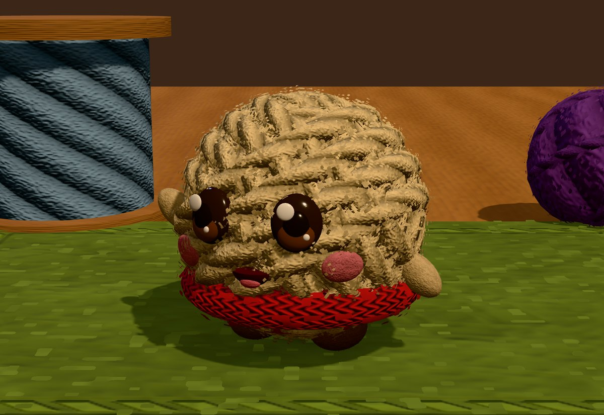
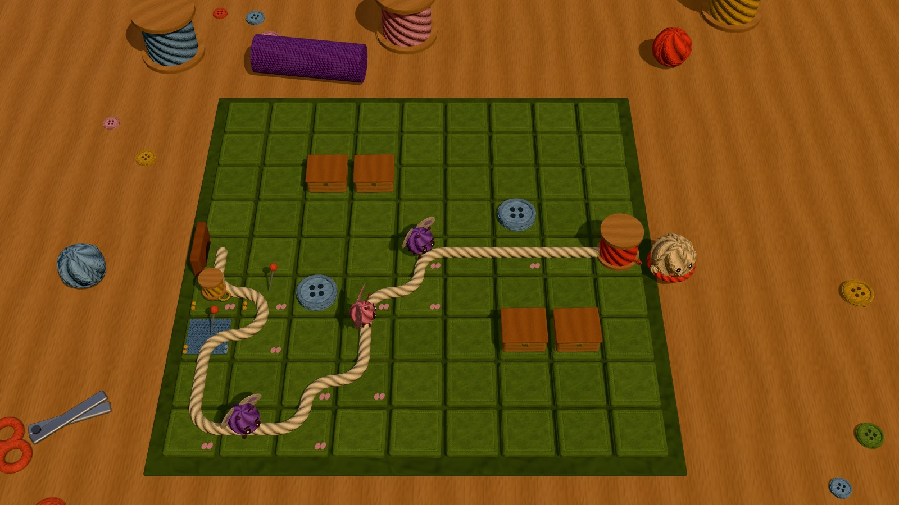

# Desenreda el Ovillo

> **Cada hilo cuenta. Cada camino es una trampa.**

Juego de estrategia por turnos para PC (Steam) hecho en **Unity 6 + URP**. Las polillas han invadido un taller de costura y quieren comerse el carrete que protege **Ovillo**. No colocas torres: **tejes el camino que las polillas están obligadas a recorrer** y lo llenas de trampas de costura. Diorama 3D artesanal de lana, fieltro y madera.





*Prototipo actual con geometría procedural (placeholders hechos a partir de la hoja de Ovillo, `Docs/Arte/referencias/ovillo_hoja_referencia.png`), renderizado fuera de Unity con la misma geometría y materiales que el juego.*

## Estado

| | |
|---|---|
| Reglas completas, deterministas y equilibradas con un laboratorio de balance | ✅ |
| 5 salas de demo diseñadas a mano, cada una con solución de referencia verificada | ✅ |
| Núcleo de simulación en C# puro + **57 pruebas** (Unity Test Runner y `dotnet test`) | ✅ |
| Prototipo **3D** jugable en Unity: tablero diorama, lana tubular con ovillito en la punta, Ovillo según su hoja (8 expresiones, llega andando, tropieza, se duele, corre, celebra), 4 polillas de hebras con caras, 5 herramientas, pelusa y sombras de contacto, presentación de la Reina, interfaz completa, sonidos provisionales | ✅ compila contra UnityEngine con 0 avisos · ⚠️ **aún no se ha abierto en el editor** (este entorno no tiene Unity) |
| Modelo OBJ de Ovillo entregado: integrado, troceado por grupos, animado y vestido con los materiales del juego (*Ajustes → Modelo de Ovillo*) | ✅ ver `Docs/04_Direccion_de_arte.md`, 4.4 |
| Arte 3D final, animaciones, música, UI final | ⏳ ver `Docs/07_Produccion_Steam_y_feria.md` |

## Abrir el proyecto en Unity

Recomendado (deja URP configurado):

1. En Unity Hub crea un proyecto nuevo con **Unity 6 LTS** y la plantilla **Universal 3D**. Ciérralo.
2. Copia sus carpetas `Packages/` y `ProjectSettings/` dentro de tu copia de este repositorio (sustituye `ProjectSettings/ProjectVersion.txt`).
3. Abre la carpeta del repositorio en Unity Hub (*Add → Add project from disk*).
4. Al cargar, el menú del proyecto crea `Assets/_Project/Escenas/Juego.unity`, la añade a la build y crea las plantillas de material. **Pulsa Play.**

También funciona abriendo la carpeta tal cual (sin URP): se verá con el pipeline integrado y sin el postproceso de maqueta.

Menú **Desenreda el Ovillo**: abrir la escena de juego · validar salas · regenerar plantillas de material · abrir la documentación. Pruebas: *Window → General → Test Runner → EditMode → Run All*.

## Controles

Clic y arrastrar: tejer la lana · 1–5 o clic en el costurero: elegir herramienta · clic: colocar · clic derecho: quitar/cancelar · Retroceso: deshacer · **Espacio: soltar a las polillas** (y cambiar velocidad) · Rueda: zum · Q/E: girar la maqueta · Esc: pausa.

## Herramientas sin abrir Unity (.NET 8)

```bash
dotnet test Tools/Pruebas                                  # las mismas 57 pruebas del Test Runner
dotnet build Tools/VerificacionUnity                       # compila los scripts de Unity contra UnityEngine
dotnet run -c Release --project Tools/Laboratorio -- informe            # regenera Docs/Balance/informe_balance.md
dotnet run -c Release --project Tools/Laboratorio -- analizar sala3 --costurero "Alfiler,Velcro,Bobina,Alfiler,Tijeras,Boton"
dotnet run -c Release --project Tools/Laboratorio -- analizar sala5 --costurero "..." --set "Reina.Vida=30"   # probar variantes
dotnet run -c Release --project Tools/Laboratorio -- fijar sala2 --costurero "..."    # guarda una solución de referencia

dotnet run -c Release --project Tools/VistaPreviaArte -- verificar          # control de calidad de las mallas (también en CI)
dotnet run -c Release --project Tools/VistaPreviaArte -- glb                # regenera Docs/Arte/Bloqueo/*.glb (modelos de bloqueo para Blender)

# Vista previa 3D (Node + Playwright):
(cd Tools/VistaPreviaArte/visor && npm install && npm run navegador)   # three.js + Playwright con Chromium
dotnet run -c Release --project Tools/VistaPreviaArte -- Tools/VistaPreviaArte/visor/datos
node Tools/VistaPreviaArte/visor/fotografiar.js Tools/VistaPreviaArte/visor captura.png escena_sala2
# escenas: escena_sala2, escena_sala5, escena_tejiendo, escena_personajes, escena_expresiones, escena_retrato,
#          cara_<expresión> (normal, feliz, guino, preocupado, susto, triste, dolor, euforia), giro_<personaje>
```

## Documentación

| Documento | Contenido |
|---|---|
| [01 · Visión y pilares](Docs/01_Vision_y_pilares.md) | Concepto, pilares, género, por qué 3D es viable en solitario |
| [02 · Reglas del juego](Docs/02_Reglas_del_juego.md) | Tablero, lana, herramientas, polillas, **orden de resolución**, decisiones y riesgos |
| [03 · Salas y progresión](Docs/03_Salas_y_progresion.md) | Las 5 salas, draft de herramientas, mejoras, reserva de hilo, reintentos |
| [04 · Dirección de arte](Docs/04_Direccion_de_arte.md) | 3D artesanal: paleta medida, materiales, fichas de personajes, cámara, luz, pipeline Blender → Unity |
| [05 · Interfaz, audio y animación](Docs/05_Interfaz_audio_animacion.md) | HUD, pantallas, controles, accesibilidad, sonido, animaciones prioritarias |
| [06 · Arquitectura técnica](Docs/06_Arquitectura_tecnica.md) | Núcleo determinista + eventos, 3D procedural, URP opcional, pruebas, CI, rendimiento |
| [07 · Producción, Steam y feria](Docs/07_Produccion_Steam_y_feria.md) | Hitos, presupuesto, riesgos, página de Steam, tráiler, feria, pruebas con jugadores |
| [Informe de balance](Docs/Balance/informe_balance.md) | Generado por el laboratorio |

## Estructura

```
Assets/_Project/Scripts/Nucleo   reglas en C# puro (sin Unity)
Assets/_Project/Scripts/Juego    presentación Unity 3D (Tres/ = geometría, materiales, modelos)
Assets/_Project/Scripts/Editor   configuración automática y utilidades
Assets/_Project/Tests/EditMode   pruebas NUnit
Assets/_Project/Resources        salas (texto), Ovillo, retratos y la copia de lectura del modelo OBJ
Assets/_Project/Arte/Modelos     modelos 3D entregados (Ovillo.obj + .mtl)
Tools/                           pruebas, laboratorio, verificación y vista previa con .NET
Docs/                            diseño, arte, producción y balance
```
